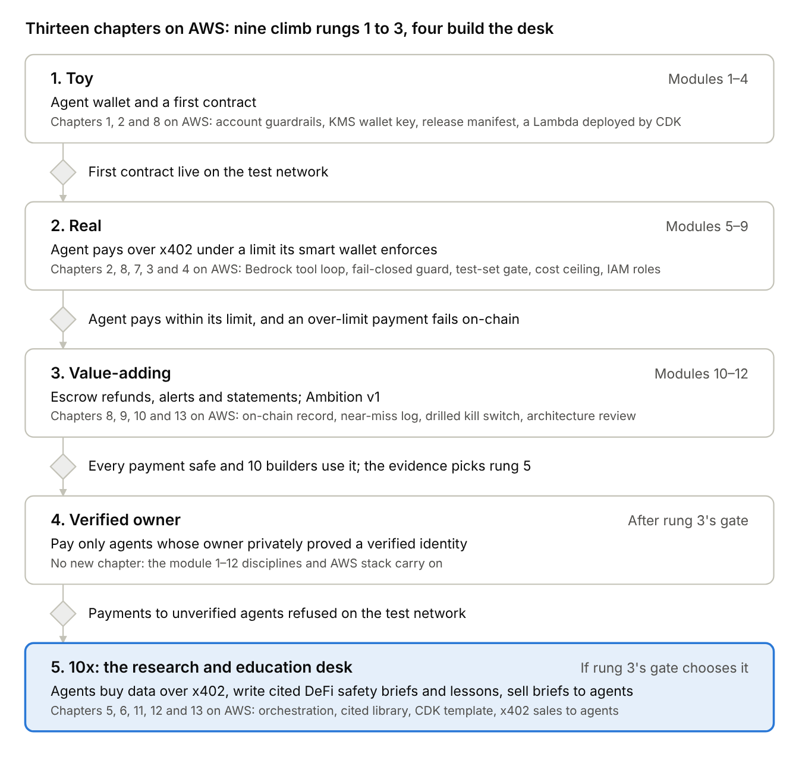
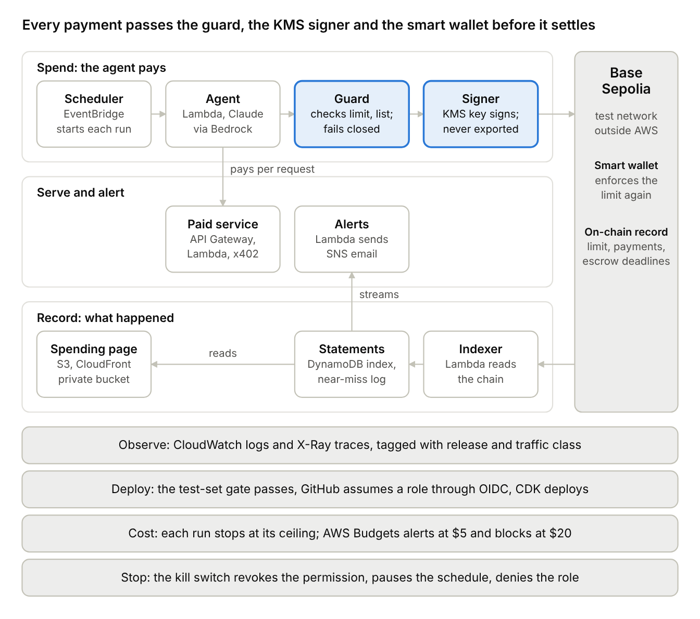

# Ambition Roadmap and Decision Register

Nov 4, 2026 · @dinky

## Summary

**Ambition is now a dateless ladder of twelve modules on AWS, and each rung ends at a gate instead of a date.** It adopts the chapters, disciplines and architecture of *Building the Agentic Enterprise* and replaces the book's Google Cloud stack with AWS. The book follows a fictional firm, ACME Research, as its Macro Research & Education Platform (MREP) grows from one agent into a governed multi-agent platform.

Dates return when the capstone course begins, so they can be set against the December 2027 graduation (D-01). Until then a module is done when its check passes and a rung is done when its gate passes, so no calendar can pull the bar down.

AWS is the cloud taught in the MSAIE's Cloud Applications and Architectures specialization, so the capstone practices what the degree teaches. Python stays the only language, because Boto3, AWS's Python toolkit, drives every AWS service. Base Sepolia still settles every payment, and GitHub Actions still tests and deploys.

Nine chapters land inside modules 1 to 12 on a serverless AWS stack, meaning AWS runs the servers and Ambition supplies only code. The agent runs on Lambda, and its key is created and used inside AWS KMS. That key signs only for a smart wallet whose own code enforces the spending limit, so the blockchain refuses an overspend even if every check in AWS fails. The other four chapters describe a DeFi research and education desk, which becomes rung 5 only if the evidence at rung 3's gate chooses it.

Six habits from the book's operating chapters now run from the first module, because each costs little to start and a great deal to retrofit. They are a release manifest, a write-back gate that fails closed, a drilled kill switch, a test-set gate, a near-miss log and a cost ceiling on every run.

Two money rules run side by side, because the blockchain spends test money while AWS and the model bill real dollars. Agents spend only play money, and Ambition issues no token (D-03). A per-run cost ceiling and an AWS budget block cap the real bill (D-21).

## Roadmap at a glance

Rungs 1 to 3 hold the twelve modules, the book's chapters add checks, and AWS adds the platform they run on. Rung 5 becomes the desk only if rung 3's gate chooses it.

## Modules 1 to 12: the book as the operating discipline

**Nine chapters change how the modules are built, not what they build.** Each row names the modules it lands in, what it adds on AWS and a check anyone can run, so rung 3 proves a working system rather than a prototype that only runs on one laptop.

| Book chapter | Lands in | What it adds, on AWS | Done when |
| --- | --- | --- | --- |
| 1. Why agentic systems fail | Modules 1–2 | Opens this Decision Register and runs each module through the book's Trinity of Value test before it is built, which guards against the PoC Trap (a demo that never reaches real use). The AWS account starts with its guardrails: a protected root login, a day-to-day admin login and a budget alarm | The register is in the repo, every later module has a one-line Done-When check, and the account passes its guardrail checklist |
| 2. The agentic AI foundation | Modules 1–6 | The agent's reason-act-observe loop runs in Lambda and calls Claude through Bedrock's Converse API, which supports tool use: read a balance, pay, call the x402 service, then check the result | In module 6 the agent buys from the x402 service unaided, and CloudWatch shows every tool call with its inputs and result |
| 8. Building and deploying agentic workflows | Modules 1–12 | The book's Terraform and Cloud Run deployment becomes an AWS CDK stack in Python, deployed by GitHub Actions. Each deploy writes a release manifest, each module ships with its Done-When written as a test, and every run is tagged with its traffic class and stops at its cost ceiling | Every merge to main deploys the stack with a manifest, and the module-9 spending audit is generated from CloudWatch Logs Insights queries |
| 7. Security, identity and guardrails | Modules 7–8 | The book's zero-trust rules become IAM and a smart wallet: one least-privilege role per Lambda, a KMS key only the agent's role may sign with, a wallet contract that enforces the limit on-chain, and GitHub deploying through OIDC. The module-8 checklist maps each OWASP agentic risk to a control | Each of the ten OWASP risks has a named control or an accepted-risk entry, and no long-lived AWS access key exists |
| 3. Single-agent and multi-agent systems | Module 9 | Agent version 1 stays one Lambda, and the register records the measurable trigger that would justify a second | Register entry D-06 names the trigger |
| 4. Core architectural patterns | Modules 9–11 | Control is split from execution: the model proposes a payment, a write-back gate checks it against the limit, the allow-list and any approval, and only then may KMS sign. The gate fails closed, so an error, a timeout or a missing record counts as no. A reconciliation step after each payment is the book's reflection pattern | A test proves that neither a fooled prompt nor a crashed gate can reach a signature |
| 9. State, memory and decision persistence | Modules 10–11 | The chain holds the record that must not be edited, and DynamoDB holds the statement index built from it. A near-miss log records every attempt the gate refused or sent for approval, and escrow plus approval above the limit become the human approval gates | Any payment traces from its statement line to its request, evidence, release, approver and transaction hash, and every refused attempt appears in the near-miss log with its reason |
| 10. AgentOps and EvalOps | Modules 11–12 | CloudWatch and X-Ray carry the observability signals. The kill switch names each hop it cuts: the spending permission, the agent's schedule and its IAM role. A test-set gate in GitHub Actions runs a quick set on every change and the full set nightly against one pass bar | Catastrophic tests pass 100% on every pull request, and a dated drill stops a test agent within a minute |
| 13. The reference architecture | Module 12 | The capstone write-up includes the AWS reference architecture, a Well-Architected review and this register, the package a reviewer asks for before backing more work | The rung-3 review shows the architecture, the review and the register |

Rows run in the order their modules start, so chapter 8 comes third and chapter 7 comes before chapter 3. The safety rules from *Building AI Agents for Finance* already in the [reading notes](research/building-ai-agents-for-finance-notes.md) carry on unchanged.

## Six habits from the first module

**Six habits from the book's operating chapters start small in the first modules, because each is cheap to begin and expensive to bolt on later.** Each one has a register row, so a change to a habit is a change to a decision.

| Habit | What Ambition does | Starts in | Book |
| --- | --- | --- | --- |
| Release manifest | Every deploy writes one file naming the model ID, prompt hashes, tool and library versions, contract addresses and limits, and every statement line names the manifest it ran under (D-13) | Module 1 | pp. 421–425 |
| Write-back gate that fails closed | Nothing the agent proposes reaches the signer until the gate passes it, and an error, a timeout or a missing record counts as no (D-07) | Module 5, complete in module 7 | pp. 303–304, 692 |
| Kill switch with named hops | The runbook names each hop the switch cuts, and a drill at every rung gate from rung 2 on, dated in the log, proves the switch still stops a test agent within a minute (D-12) | Module 7, first drill in module 8 | pp. 524, 707 |
| Test-set gate | The test set holds at least 20 cases. A quick set runs on every change and the full set nightly, against one pass bar, so no change passes on an easier standard (D-11) | Module 6 | pp. 605, 705 |
| Near-miss log | Every payment the gate refused or sent for approval is logged with its reason, because a near miss is the cheapest warning a system gives (D-10) | Module 7 | p. 467 |
| Cost tags and a per-run ceiling | Every model call carries a traffic-class tag, such as agent run, test set or reader service. At 90% of a run's ceiling the agent switches to a cheaper model, and at 100% the run stops (D-21) | Module 6 | pp. 411, 518 |

## What the blockchain specialization changes

**The MSAIE blockchain specialization sharpens four points, and each one moves a rule out of trust and into code anyone can check.**

**Critical data lives on the chain.** The spending limit, every payment and every escrow deadline are recorded on Base Sepolia, where nobody, Ambition included, can quietly edit them. DynamoDB keeps only the statement index and the near-miss log, and the index can be rebuilt from the chain if it is ever lost (D-10).

**The KMS key signs for a smart wallet that enforces the limit.** From module 7 the agent's money sits in a smart wallet, an account run by contract code rather than by one key. The KMS key may only ask that wallet to pay, and the wallet checks the limit itself, so a guard bug in AWS still meets a second lock on-chain (D-07).

**Desk briefs use one fixed frame.** Each brief places a protocol on Fabian Schär's five DeFi layers (settlement, asset, protocol, application and aggregation) and checks it against five DeFi risks: flaws in its smart contracts, weak governance, unreliable outside data, thin liquidity and uneven regulation. A fixed frame makes briefs comparable across protocols and keeps them on risk rather than price (D-05).

**No token.** Ambition issues no token of any kind, because a token would give people a price to speculate on and would pull a safety toolkit toward the investment advice it promises not to give (D-03).

## The AWS architecture

**Every payment passes a gate in code, a signature inside KMS and the smart wallet's own limit before it settles.** Each job Ambition does gets one managed AWS service, the cloud-native method the curriculum teaches, and no part runs on a server Ambition must patch.

The agent can propose any payment, but only the guard can pass one to the signer, only the signer holds the key, and the wallet refuses anything over its limit.

**The design answers each of AWS's six Well-Architected pillars with a named control, and the rung-3 review checks them again.**

| Pillar | Ambition's answer |
| --- | --- |
| Operational excellence | Only GitHub Actions deploys, through the CDK stack; every deploy writes a release manifest, every run writes a structured log, and the kill switch is drilled at every rung gate from rung 2 on |
| Security | One least-privilege role per Lambda, a wallet key that signs only inside KMS for a smart wallet that enforces its own limit, OIDC instead of stored keys, and a protected root login |
| Reliability | Lambda and DynamoDB run across several Availability Zones; reads retry with backoff, payments carry idempotency keys and never retry blindly, and the gate fails closed |
| Performance efficiency | Each function gets its own memory size, and DynamoDB reads by wallet address, its fastest kind of lookup |
| Cost optimization | Lambda and DynamoDB stay inside their always-free allowances, no NAT gateway runs, every run stops at its cost ceiling, and AWS Budgets alerts and then blocks (D-21) |
| Sustainability | Nothing runs while idle, and DynamoDB TTL clears stale records |

## The AWS build, module by module

**AWS joins in module 1 with a small foundation, then adds one service at a time as each module needs it.** If the module-1 foundation runs long, the module ships on the local script and the Lambda follows in module 2, because a gate moves the schedule, never the bar.

| Module | What it builds | Reader challenge | What runs on AWS |
| --- | --- | --- | --- |
| 1 | An agent wallet on Base Sepolia and a script that reads its transactions | Make a practice wallet, send yourself test ETH and reply with the block-explorer link | Account guardrails: a protected root login, a day-to-day admin login and a budget alarm. The wallet key is created in KMS, and the read script runs as a Lambda that CDK deploys from GitHub Actions through OIDC, writing the first release manifest |
| 2 | A notebook that turns the agent's activity into a statement | Find the block that holds your transaction and reply with its number | An indexer Lambda writes the agent's transactions to DynamoDB, and the notebook reads them with Boto3 |
| 3 | First smart contract, written in Remix | Deploy Remix's sample contract to the testnet and reply with its address | No new service, because the contract lives on the blockchain; the CDK stack gains its first tests |
| 4 | The phone book deployed to Base Sepolia | Add an entry; each one is public proof | A separate KMS deployer key, usable only by the GitHub deploy role, signs the deployment, so no deploy key sits on a laptop |
| 5 | Test USDC and a script that pays another wallet | Send 1 test USDC between two of your own wallets and reply with the link | The pay Lambda signs with KMS behind a first write-back gate that fails closed, and EventBridge Scheduler starts each run |
| 6 | A paid x402 service and an agent that pays it | Pay the test service once from your own wallet or script | The service runs on API Gateway and Lambda, the agent's loop calls Claude through Bedrock with a traffic-class tag and a per-run ceiling, and the test set starts with 20 cases |
| 7 | A daily spending limit enforced by a smart wallet | Send the agent 1 test USDC to fund its next purchase | The limit lives in the wallet's contract, the guard Lambda checks it and a DynamoDB allow-list before KMS signs, and refused attempts go to the near-miss log |
| 8 | Tests and the security checklist | Grant, then cancel, a spending permission and reply with the cancellation | An IAM review, the OWASP mapping, a first Well-Architected review and the first dated kill-switch drill |
| 9 | Agent version 1 buys data and logs every payment | Call the paid service from your own code | X-Ray traces every run, and the spending audit comes from CloudWatch Logs Insights |
| 10 | Money-back escrow | Pay into the escrow, let the deadline pass and reply with your refund link | The contract enforces the deadline, and a one-time EventBridge Scheduler schedule claims the refund once it passes |
| 11 | Spending alerts and a public spending page | Run the alert script on your practice wallet, trip it and reply with the link | DynamoDB Streams trigger an alert Lambda that emails through SNS, and CloudFront serves the page from a private S3 bucket |
| 12 | Ambition version 1 and the capstone-style write-up | Install Ambition, or say what it should do next | The architecture diagram, the Well-Architected review, a cost report from AWS Cost Explorer and the rung-3 gate review |

**Readers never need an AWS account.** Every reader challenge stays on the blockchain, and Ambition's library runs on a laptop, so the CDK stack is the reference deployment for builders who want it rather than a requirement (D-23).

## After rung 4: the research and education desk

**If rung 3's gate chooses it, the desk becomes rung 5 and is built one chapter at a time after the verified-owner gate.** The ladder lets each rung pass its gate before the next begins, so the desk's stages carry no dates either, and a missed gate holds the next stage rather than lowering the bar.

The desk is Ambition's first serious user. Its agents get money only through Ambition's wallet, limit, escrow and statements, so every brief also tests the toolkit under real load.

| Book chapter | Lands in | What Ambition builds on AWS | Done when (starting targets) |
| --- | --- | --- | --- |
| 5. Multi-agent orchestration | Desk 1 | One research agent buys public data over x402 and writes a DeFi safety brief and a beginner lesson, each on Schär's five layers and the five DeFi risks. An analyst, an educator and an editor that supervises the others join one at a time, each only after evaluation shows a gain. Strands Agents and Bedrock AgentCore compete for the orchestration layer (D-24) | Four briefs in a row, every claim cited and every run under its cost ceiling |
| 6. Context, memory and knowledge | Desk 2 | The context moat: a cited library in S3 of protocol docs, contract audits, exploit post-mortems and public sanctions lists, which name crypto wallet addresses, searched by meaning and by keyword. The search index is chosen by cost | A 50-question test set answered with sources, and "insufficient evidence" returned whenever the library lacks the answer |
| 11. Platform engineering | Desk 3 | A paved road: a CDK template that deploys a wallet, limit, statements, logs and evaluations into a reader's own AWS account, plus a guide for adding a desk agent. Runs longer than Lambda's 15-minute limit move to Fargate | One reader, not the maintainer, deploys an agent from the template that passes the test-set gate |
| 12. Operating models and business transformation | Desk 4 | Service-as-Software: other builders' agents pay per brief over x402 through API Gateway on the test network, which is business-to-agent commerce. Each workflow gets a RACI saying who is responsible, accountable, consulted and informed | Ten outside agents have paid for a brief, every workflow has a RACI, and an evidence review decides whether to form the company |
| 13. The reference architecture, final | Desk 5 | The AWS architecture, Well-Architected review and register updated for the final capstone submission | Submitted ahead of the December 2027 graduation, on the schedule the capstone course sets |

**The desk researches risk and safety, never prices.** It explains what could go wrong in a protocol or a counterparty and teaches beginners how to check, but it makes no price calls, trade signals or personal recommendations. That keeps it on the research-and-education side of the line, keeps the plan's rule that nothing here is financial advice, and plays to Ambition's mission.

## The rung-3 decision gets a fifth row

**The desk competes on evidence like every other path, so it enters the plan as one more row of the rung-3 decision table.** The row is part of D-01 and appears in the [build-in-public plan](build-in-public-plan.md).

| If at rung 3's gate… | Then |
| --- | --- |
| Readers keep completing the lesson challenges and builders pay the x402 service from their own code | Choose the research and education desk as rung 5, because it serves both signals at once: people who want to learn and builders who will pay agents for data |

## How the books and the curriculum are used

**Ambition adopts the book's chapters, disciplines and architecture, and swaps each Google Cloud piece for its AWS counterpart.** The swap follows the cloud-native method the curriculum teaches: list each job the app must do, then give each job one managed service.

| The book on Google Cloud | Ambition on AWS | Why this one |
| --- | --- | --- |
| Agent Development Kit (ADK) | Bedrock's Converse API through Boto3 for one agent; Strands Agents or Bedrock AgentCore scored at the desk (D-24) | A plain loop keeps every reason-act-observe step visible while there is one agent |
| Gemini models | Claude on Amazon Bedrock, with model IDs pinned in the release manifest (D-13) | The Lambda's IAM role authorizes each call, so there is no model API key to leak |
| Cloud Run | AWS Lambda, with Fargate for runs over 15 minutes (D-18) | Lambda bills per request and leaves server patching to AWS |
| Workload identity | IAM roles, with GitHub OIDC for deployments (D-20) | Short-lived credentials replace stored keys |
| VPC Service Controls and perimeter | Least-privilege IAM now; a VPC across two Availability Zones once a private resource exists (D-18) | Nothing private needs a network yet, and a NAT gateway bills every hour |
| Data residency on Cloud Run | One region, us-east-1 (D-18) | Every record stays in one region |
| ADK session and memory services | DynamoDB, keyed by wallet address and rebuilt from the chain when needed (D-10) | Fast reads by key, flexible records and Streams for alerts |
| Structured logging and tracing | CloudWatch Logs and X-Ray | Both are built into Lambda |
| Terraform | AWS CDK in Python (D-18) | Infrastructure lives in the same language as the code |
| Cloud Build | GitHub Actions | It is already Ambition's CI |
| Gemini Enterprise adoption layer | Not needed | Ambition's users are builders, not employees in an enterprise rollout |

**One piece has no counterpart in the book: the wallet key.** It is created inside AWS KMS as a secp256k1 key, the type Ethereum and Base use, and it signs there, so the private key never leaves AWS's hardware. It signs only for the agent's smart wallet, which enforces the limit on its own (D-07).

**Neither the books nor the course materials go into Git.** This roadmap summarizes *Building the Agentic Enterprise* in its own words and cites it by chapter and page, the same rule the reading notes set for the other book. The Quantic specialization summaries stay private too, because their copyright and the Student Code of Conduct bar sharing them, so every AWS and blockchain fact here cites a public source (D-15).

## Decision Register

**Seventeen decisions make up the register: twelve accepted and five proposed.** It is Ambition's version of the MREP Decision Register from chapter 13, the record of every decision the design rests on. The book's own register holds fifteen rows and warns that one past thirty means decisions are being argued again, so related rows were merged rather than added.

On November 4, 2026, D-02 merged into D-01, D-04 into D-03, D-09 into D-05, D-19 into D-07, D-26 into D-10, D-22 and D-25 into D-18, and D-14 into D-20. D-08 was withdrawn the same day when AWS took its place (D-17). No retired number is reused, so a new decision takes the next ID, D-27, and each status changes as its decision moves.

| ID | Decision | Status | Why | Revisit when | Chapter |
| --- | --- | --- | --- | --- | --- |
| D-01 | The plan is a dateless ladder: modules 1 to 12 climb rungs 1 to 3, each rung ends at a gate, the research and education desk is only an option for rung 5, and dates return when the capstone course begins | Accepted | A gate holds the bar where a date invites lowering it, and the capstone course will set the real deadlines against the December 2027 graduation | When the capstone course begins | 1, 12 |
| D-03 | Agents spend only test money on Base Sepolia, never touch a real-money account, and Ambition issues no token; the desk may read real-network data but spends only on the test network | Accepted | Payments are final, beginners copy what the build does, reading moves no money, and a token would invite speculation | After an independent contract audit | 7 |
| D-05 | Desk briefs cover risk, safety and lessons, never price calls, trade signals or personal recommendations; each places a protocol on Schär's five DeFi layers, checks the five DeFi risks, cites every claim and may answer "insufficient evidence" | Accepted | A fixed frame makes briefs comparable, sources let readers check them, and a cited "don't know" beats a confident guess | Desk 2 test set, and before any paid offer to people | 6, 12 |
| D-06 | One agent with tools carries modules 1 to 12; a second joins only when evaluation shows a measurable gain | Accepted | More agents add cost and failure modes before they add value | When the test set shows one agent missing its Done-When because its context is too full | 3 |
| D-07 | Control lives outside the model: a write-back gate checks the limit, the allow-list and any approval and fails closed; the KMS key signs only for a smart wallet whose contract enforces the limit again; no private key sits in a file, variable, prompt or repo | Accepted | A fooled model or a crashed gate still cannot overspend, and a key that never leaves KMS can't leak through the model, a log or a commit | Only ever tightened | 4, 7 |
| D-10 | The chain records what must not be edited: the limit, each payment and each escrow deadline. DynamoDB holds the statement index, rebuildable from the chain, binding request, evidence, release manifest, gate decisions, approver and transaction hash, plus a near-miss log of every refused or escalated attempt; TTL only tidies old records | Accepted | Anyone can verify the money on-chain, the index explains why it moved, near misses warn before a loss, and AWS deletes expired TTL items "within a few days", not at a deadline | Module 10 | 9 |
| D-11 | A test-set gate runs in CI: at least 20 cases, a quick set on every change, the full set nightly and one pass bar, with catastrophic failures (overspending, a wrong recipient, a leaked key) required to pass 100% | Accepted | The book shows even a small test set catches regressions early, and one bar stops a change passing on an easier standard | Module 11 | 10 |
| D-12 | The kill switch names every hop it cuts (the spending permission, the EventBridge schedule and an IAM deny on the agent's role) and is drilled at every rung gate from rung 2 on, with each drill dated in the log | Accepted | One hop stops the spending, one stops the runs and one stops every AWS call, and only a drill proves they still work | Each rung gate | 10 |
| D-13 | Every deploy writes a release manifest pinning model IDs, prompt hashes, tool and library versions, contract addresses and limits, so a prompt change is a code change | Accepted | Any result traces to the exact release that produced it | Every release | 8, 10 |
| D-15 | Book PDFs and course materials stay out of Git; docs summarize them in their own words and cite chapters, pages or public sources | Accepted | The repo is public and mirrored, and the books' copyright, the course's copyright and the Student Code of Conduct bar sharing them | Never | — |
| D-16 | Briefs are sold to other agents over x402 on the test network before any real-money pricing | Proposed | It proves business-to-agent demand at no risk | Desk 4 | 12 |
| D-17 | AWS is Ambition's cloud platform from module 1, replacing the book's Google Cloud; Python, Base Sepolia and GitHub Actions keep their roles | Accepted | The MSAIE specialization teaches AWS, and Boto3 keeps every service in Python | Rung-3 cost and Well-Architected review | 2, 8 |
| D-18 | Serverless first, written as AWS CDK code in Python and run in one region, us-east-1: Lambda, API Gateway, DynamoDB, S3 and CloudFront, with no EC2 servers and no VPC until a private resource exists, then two Availability Zones | Proposed | AWS patches managed services, idle functions cost nothing, one language covers the app and its infrastructure, and a NAT gateway bills every hour it exists | When a run needs more than Lambda's 15 minutes (Fargate), a private database is added, or CDK blocks a needed service | 4, 7, 8, 11 |
| D-20 | One least-privilege IAM role per Lambda, GitHub Actions deploys through OIDC, no long-lived AWS access keys exist, and the module-8 checklist maps every OWASP agentic risk to a control or an accepted risk | Proposed | Short-lived credentials can't be stolen from a repo secret or a laptop, and a standard list is harder to skip than a homemade one | Module-8 IAM review | 7 |
| D-21 | Cost has its own limits: every model call carries a traffic-class tag, each run has a ceiling (at 90% it switches to a cheaper model, at 100% it stops), and AWS Budgets alerts at $5 a month and denies the agent roles at $20 | Accepted | Cloud and model costs are real dollars even while the blockchain's money is not, and a per-run ceiling stops a runaway loop long before a monthly alarm would | Desk 1 start | 10, 12 |
| D-23 | Ambition's library runs on a laptop with no cloud account; the CDK stack is the reference deployment, and reader challenges never need AWS | Proposed | Readers stay free and sign-up-free, and the toolkit stays portable | Desk 3 paved road | 11 |
| D-24 | The single agent calls Bedrock's Converse API directly through Boto3; Strands Agents or Bedrock AgentCore joins at the desk only if it wins the nine-dimension scoring from *Building AI Agents for Finance* | Proposed | A plain loop shows every reason-act-observe step while there is one agent | Desk 1 start | 2, 5 |

The dollar amounts in D-21 and the 20-case floor in D-11 are starting values, set now so later results can't be explained away, and each is revisited when its row says.

## Plain-language terms

**Every term this roadmap adds is defined here, in the same plain style as the design guidelines' glossary.**

| Term | Plain meaning |
| --- | --- |
| API Gateway | An AWS service that gives code a web address and decides which function answers each request |
| Audit trail | A record that shows what an agent did, why, with which release and who approved it, so anyone can check it later |
| Availability Zone | One of several separate data centers inside an AWS region, so a local outage doesn't stop the app |
| AWS Budgets | AWS's spending alarms, which can also block chosen roles once the bill passes a set amount |
| AWS CDK | A toolkit for describing AWS resources in Python code, so the whole setup can be reviewed, tested and rebuilt |
| Base Sepolia | Coinbase's free practice blockchain, where all of Ambition's money is test money |
| Bedrock | AWS's service for calling AI models such as Claude, authorized by AWS roles instead of a separate API key |
| Boto3 | AWS's Python library for calling AWS services from code |
| Business-to-agent commerce | Selling to other companies' AI agents rather than to people, here by charging per request over x402 |
| CloudFront | AWS's content-delivery network, which serves a web page quickly while its storage bucket stays private |
| CloudWatch | AWS's logs and metrics service, where every Lambda writes what it did |
| Context moat | Knowledge a competitor can't easily copy, fed to the agents so their answers beat a general model's |
| Contract account | A blockchain account run by smart-contract code instead of a single key, so its own rules decide what it may do |
| Contract audit | An expert review of a smart contract's code that looks for ways money could be lost |
| Cost ceiling | The most one agent run may spend on models and services; near it the agent switches to a cheaper model, and at it the run stops |
| Counterparty | Whoever is on the other side of a payment or deal, such as the wallet an agent pays |
| Decision Register | One table of every decision the design rests on, with its reason and when to revisit it |
| DeFi | Decentralized finance: lending, trading and payments run by smart contracts instead of a bank |
| DeFi layers | Schär's five layers of DeFi: settlement (the blockchain), asset (the tokens on it), protocol (rules such as lending or exchange), application (the apps people use) and aggregation (apps that combine several) |
| Done-When | A check anyone can run that says a piece of work is finished, written before the work starts |
| DynamoDB | AWS's database that stores records by a key and needs no server to manage |
| EOA | An externally owned account: a blockchain account controlled by one private key, so whoever holds the key can spend everything in it |
| EventBridge Scheduler | An AWS service that starts a function at a set time or on a repeating schedule |
| Exploit post-mortem | A write-up of how a protocol lost money to an attack and what fixed it |
| Fail closed | When a check breaks, times out or lacks the data it needs, its answer is no |
| Finality | The point after which a blockchain payment can no longer be reversed |
| Gas | The small fee a blockchain charges to run a transaction, paid here in test ETH |
| Governance | How a DeFi protocol's rules get changed, and who is allowed to change them |
| IAM role | A set of AWS permissions that code takes on for a short time, instead of holding a password or key |
| Kill switch | A fast way to stop an agent: here, cancelling its spending permission, pausing its schedule and denying its role |
| KMS | AWS Key Management Service, which keeps keys inside secure hardware and signs with them there |
| Lambda | AWS's way to run a function without managing a server; it runs on demand and bills per request |
| Layer 2 | A blockchain such as Base that bundles many transactions and settles them on Ethereum, which makes each one cheaper; Base's kind is called a rollup |
| Liquidity | How easily an asset can be bought or sold without moving its price |
| NAT gateway | A paid AWS router that lets private machines reach the internet, billed every hour it exists |
| Near-miss log | A record of every payment the gate refused or sent for approval, with its reason, read for warnings before a real loss |
| OIDC | A standard that lets GitHub prove who it is to AWS and receive short-lived credentials, so no AWS key is stored |
| Oracle | A service that brings outside data, such as a price, onto the blockchain for contracts to use |
| Orchestration | One supervising agent hands tasks to helper agents and checks their work |
| PoC Trap | The book's name for a proof of concept that impresses in a demo but never reaches real use |
| Protocol | A DeFi service built from smart contracts, such as a lending market |
| RACI | A chart naming who is Responsible, Accountable, Consulted and Informed for each task |
| Reason-act-observe loop | How an agent works: it decides what to do, uses one tool, looks at the result, then decides again |
| Region | An AWS geographic area, such as us-east-1 in northern Virginia, made of several Availability Zones |
| Release manifest | One file per deploy listing exactly which model, prompts, tools, contracts and limits are running |
| S3 | AWS's file storage, organized in buckets |
| Sanctions list | A government list of people, companies and, in the US, crypto wallet addresses that may not be paid |
| secp256k1 | The type of cryptographic key Ethereum and Base use to sign transactions |
| Serverless | Building with services AWS runs and patches, so Ambition supplies only code and settings |
| Service-as-Software | The book's term for selling the finished work an agent does, rather than the software that does it |
| Shared responsibility model | AWS secures the cloud itself, and the customer secures what it puts in the cloud |
| Smart wallet | A contract account built to hold money, whose code can enforce rules such as a daily spending limit |
| SNS | AWS's notification service, used here to email alerts |
| Stablecoin | A token designed to hold a steady value, such as USDC at one US dollar |
| Test set | A fixed list of tasks with known right answers that every change must pass |
| Time to live (TTL) | A DynamoDB setting that deletes old records automatically, within a few days of a chosen time |
| Token | A digital asset recorded on a blockchain; Ambition issues none |
| Traffic class | A tag on every model call saying what it was for, such as an agent run, a test or a reader request, so costs can be split by purpose |
| VPC | A private network inside AWS, split into smaller networks called subnets |
| Well-Architected Framework | AWS's six-pillar checklist for judging a cloud design |
| Write-back gate | The checkpoint between what an agent proposes and anything that changes the world, such as a payment |
| x402 | Coinbase's standard for agents paying for things on the web, one request at a time |
| X-Ray | AWS's tracing service, which follows one request through every function it touches |

## Sources

- Jaroslav Pantsjoha, [*Building the Agentic Enterprise*](https://www.oreilly.com/library/view/building-the-agentic/9781807604455/) (Packt, September 2026), the MREP case study, the chapter structure mapped here and the six habits, cited by page
- Hanane Dupouy and Fayssal El Mofatiche, [*Building AI Agents for Finance*](https://reference-global.com/book/9781837022281) (Packt, 2026), with Ambition's adopted rules in the [reading notes](research/building-ai-agents-for-finance-notes.md)
- Ambition, [Build in Public: Mission and Ladder](build-in-public-plan.md), the modules, ladder, gates and rung-3 decision this roadmap keeps
- Fabian Schär, [Decentralized Finance: On Blockchain- and Smart Contract-Based Financial Markets](https://www.stlouisfed.org/publications/review/2021/02/05/decentralized-finance-on-blockchain-and-smart-contract-based-financial-markets), *Federal Reserve Bank of St. Louis Review*, Second Quarter 2021, pp. 153–74, the source of the five DeFi layers
- Coinbase Developer Platform, [Spend Permissions](https://docs.cdp.coinbase.com/wallet-api/v2/evm-features/spend-permissions), on allowances a smart wallet enforces on-chain
- OWASP GenAI Security Project, [OWASP Top 10 for Agentic Applications for 2026](https://genai.owasp.org/resource/owasp-top-10-for-agentic-applications/) (December 9, 2025)
- US Treasury, [OFAC FAQ 563](https://ofac.treasury.gov/faqs/563), on how the sanctions list records digital currency addresses
- AWS, [Well-Architected Framework, Sustainability Pillar](https://docs.aws.amazon.com/wellarchitected/latest/sustainability-pillar/sustainability-pillar.html), which lists the framework's six pillars
- AWS, [Lambda quotas](https://docs.aws.amazon.com/lambda/latest/dg/gettingstarted-limits.html), on the 15-minute function timeout
- AWS, [Converse API reference](https://docs.aws.amazon.com/bedrock/latest/APIReference/API_runtime_Converse.html), on tool use through `toolConfig`
- Chainlink, [AWS KMS Signer](https://docs.chain.link/crec/guides/signers/aws-kms), on signing with an `ECC_SECG_P256K1` KMS key whose private key never leaves AWS's hardware
- GitHub, [Configuring OpenID Connect in Amazon Web Services](https://docs.github.com/en/enterprise-server@3.13/actions/deployment/security-hardening-your-deployments/configuring-openid-connect-in-amazon-web-services), on deploying without long-lived AWS secrets
- AWS, [Configuring budget actions](https://docs.aws.amazon.com/awsaccountbilling/latest/aboutv2/budgets-controls.html), on applying an IAM policy when a budget passes its threshold
- AWS, [Pricing for NAT gateways](https://docs.aws.amazon.com/vpc/latest/userguide//nat-gateway-pricing.html), on hourly and per-gigabyte charges
- AWS, [Using time to live (TTL) in DynamoDB](https://docs.aws.amazon.com/amazondynamodb/latest/developerguide/TTL.html), on deletion "within a few days" and TTL deletes in Streams
- AWS, [Invoke a Lambda function on a schedule](https://docs.aws.amazon.com/lambda/latest/dg/with-eventbridge-scheduler.html), on one-time and recurring EventBridge Scheduler schedules
- AWS, [Restrict access to an Amazon S3 origin](https://docs.aws.amazon.com/AmazonCloudFront/latest/DeveloperGuide/private-content-restricting-access-to-s3), on keeping the bucket private behind CloudFront
- AWS Builder Center, [Everything you need to know to get started with AWS Free Tier](https://builder.aws.com/content/3BlPcDGddaB6WkPvUf1LIy1rzIm/everything-you-need-to-know-to-get-started-with-aws-free-tier) (May 2026), on credits and always-free Lambda and DynamoDB allowances
- AWS Builder Center, [The AWS agentic stack explained: Strands, AgentCore, MCP and A2A](https://builder.aws.com/content/3DIxoOSFNpRg1hdLEbH8X9ncyug/the-aws-agentic-stack-explained-strands-agentcore-mcp-and-a2a), on Strands Agents and AgentCore's October 2025 general availability
