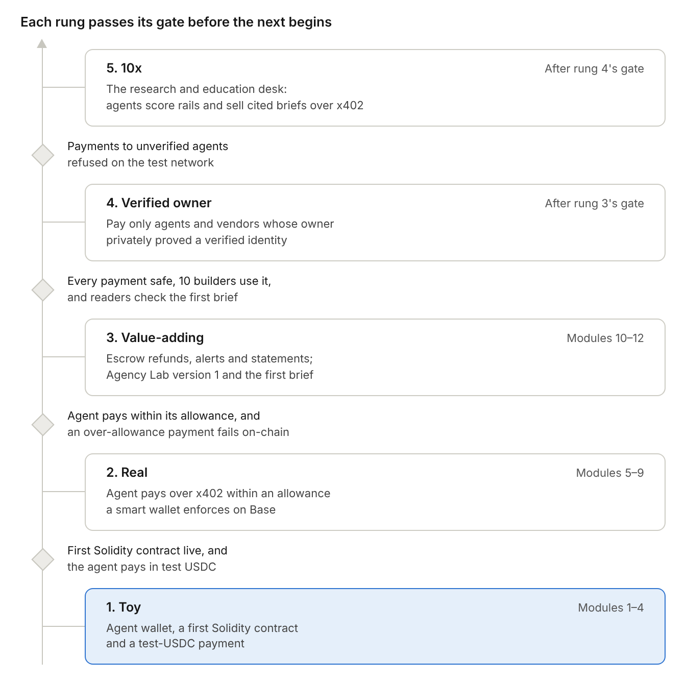

# Build in Public: Mission and Ladder

Nov 8, 2026 · @dinky

## Summary

**You build Agency Lab one module at a time, twelve modules in all, on Base Sepolia, Base's free test network, and each module gives readers one challenge they can prove they did.** Agency Lab is an agentic commerce research and education platform: a toolkit that lets an AI agent hold and spend stablecoins safely, a research desk that scores payment rails and stablecoins, and lessons that teach both. It runs on AWS, its contracts are written in Solidity and everything else is Python. Agency Lab is also your capstone. 50T Funds argues that blockchains will become the financial infrastructure for billions of AI agents, which is why this plumbing is worth learning in public.

The ladder runs from an agent with its own wallet, to an agent that pays for services within an allowance the chain enforces, to Agency Lab version 1, with money-back escrow, alerts and a first published scorecard brief. Each rung ends at a gate anyone can check rather than at a date, and dates return when your capstone course begins, so they can be set against your December 2027 graduation. Readers who complete challenges leave public records on Base Sepolia, so demand shows up as actions you can count, and at rung 3's gate that evidence decides which part of Agency Lab grows fastest.

## Mission statement

> **Help AI builders give their agents money safely, one small win at a time.**

Your class's rule says a good mission names the behavior you want and leaves out features, and this one does. "Give their agents money safely" is the behavior, and it covers everything Agency Lab builds, from wallets and allowances to refunds and alerts. "One small win at a time" keeps the least-to-most method, and "safely" keeps the play-money promise.

The mission names no product, protocol or blockchain, so the build can change without changing it, which is exactly what happened when it moved to AWS and Base. Its audience is AI builders learning to give agents money, which is exactly who you are: an AI engineer learning blockchain.

**The name says what the platform studies.** Jaroslav Pantsjoha writes that the feedback in an agent's reason-act-observe loop is what separates agency from ambition, because an agent changes course on what actually happened (*Building the Agentic Enterprise*, p. 32). Agency Lab studies agents acting for the people who own them, and "Lab" says it is a place for research and education ([P-25](decisions/P-25-agency-lab-name.md)).

## The ladder

**You climb from toy programs to a product in five rungs, and each gate is a fact anyone can check.**

The twelve modules cover the first two rungs and the start of the third. A missed gate holds the next rung rather than lowering the bar, the same rule as your earlier plans. Rung 5 is the research and education desk, where research agents score rails and stablecoins and sell cited briefs to other agents.

**The verified-owner rung comes after rung 3's gate.** Your agent pays only agents and vendors whose owner has proved a verified identity with a zero-knowledge proof, which is math that proves a fact without revealing the data behind it, like an "over 21" card with no name on it. Agency Lab reuses existing tools rather than building identity itself: passport-chip proof apps such as Self and ZKPassport for the owner, and an on-chain agent ID such as the draft ERC-8004 standard for the agent, both checked on Base. The proof shows that a real, verified person stands behind an agent, but not who, and the allowance and escrow still do the safety work.

## The twelve modules

**A module is done when its check passes, not when a set number of hours runs out.** Each module splits its time about the same way: roughly five parts building, one part turning your build notes into plain-language notes, one part answering readers and counting completions, and one part having an AI quiz you until you can teach it. Every module ships working code on Base Sepolia, Solidity where the code runs on the chain and Python everywhere else, and most challenges leave proof there that anyone can check.

| Module | What you build | Reader challenge |
| --- | --- | --- |
| 1 | An AI agent with its own wallet on Base Sepolia, whose key is created inside AWS KMS, plus a Python script that reads its transactions | Get test ETH from a Base Sepolia faucet, send some to yourself and reply with the block-explorer link |
| 2 | A statement: a script that turns the agent's activity into a readable record and explains what a block, a transaction hash and finality are | Find the block that holds your transaction and reply with its number |
| 3 | Your first Solidity contract, tested with Foundry: a shared registry where agents list a name and a price per request | Add an entry; each one is public proof |
| 4 | Test USDC, a digital dollar, from Circle's faucet, and a payment from your agent to another wallet, which closes rung 1's gate | Send 1 test USDC between two of your own wallets and reply with the link |
| 5 | A spending allowance enforced by a smart wallet, an account whose spending rules live in code, with a budget, an expiry and an allowed-recipient list that you can suspend or revoke | Grant, then revoke, an allowance and reply with the revocation |
| 6 | A tiny paid service that charges per request over x402, the open standard for agents paying on the web, and an agent that pays it and keeps the receipt with its request | Pay the service once and reply with the settlement transaction |
| 7 | Gasless payments: the agent pays USDC with a signed authorization whose gas the facilitator pays, and a new reader pays from an email-login smart account whose gas is sponsored | Make a first payment from a sponsored smart account and reply with the link |
| 8 | Tests, a security checklist and a first kill-switch drill, while the UX agent drafts the style guide and design tokens | Try to overspend a test allowance and reply with the failed transaction |
| 9 | Agent version 1: buys data over x402, stays under its allowance and logs every payment and refusal, then does the same task through AWS's managed payment service so you can compare the two | Call the paid service from your own code |
| 10 | Money-back escrow: a contract that holds an agent's payment until the service delivers and refunds it automatically after a deadline | Pay into escrow, let the deadline pass and reply with your refund |
| 11 | Spending alerts: a script that watches the agent's wallet and messages you when it nears its allowance or pays a new address, plus a public spending page | Trip an alert on your practice wallet and reply with the link |
| 12 | Agency Lab version 1, a capstone-style write-up of requirements, design, tests and results, and the first scorecard brief | Read the brief and score one rail or stablecoin yourself |

The [roadmap](roadmap.md) shows what each module adds on AWS, the scorecard the research desk uses, and the decisions every module rests on.

## Spending limits: build one, then compare

**You write your own allowance contract in module 5 because building it teaches the lesson, then you test it against Coinbase's production version in module 8.** Coinbase already offers Spend Permissions on Base, so a builder who only wants a safe agent today can skip your contract, and your notes should say so. A permission names who may spend (the spender), which token, the most they may spend (the allowance) and the window it covers, such as a day. One shared contract on the blockchain enforces it, and the owner can cancel it at any time. It runs on Base Sepolia, the same practice network as the rest of this plan, and it works with a smart wallet, which is why it fits the module 8 comparison.

**From module 5 the agent's money sits in a smart wallet, and its key can only ask that wallet to pay.** The key is created inside AWS KMS and never leaves it, and the wallet checks the allowance itself, so an overspend fails on the blockchain even if every check before it fails.

| Question | Your module 5 contract | Coinbase Spend Permissions |
| --- | --- | --- |
| Who wrote and audited it | You, as a learning build, so treat it as unaudited | Coinbase, as a shared contract deployed on many networks |
| What it limits | One budget, one expiry and an allowed-recipient list per agent | An allowance per window, per token, per spender |
| How it ends | Owner revokes it or lets it expire | Owner revokes it using the permission's hash, its unique fingerprint, or the end date passes |
| What a builder learns | How a limit is enforced line by line | How to use a production tool in a few lines |

Compare them on the same task in module 8 and publish the result, including anything Coinbase's version does that yours can't. If it holds up, Agency Lab's limit editor and spending meter can work with either contract, and you recommend the audited one for anything beyond a testnet.

**Delegation can only narrow.** When one agent hands a task to a helper, the helper receives a slice of the delegator's remaining budget and window, never more, and the slice comes out of the delegator's own allowance so the total can't grow. A buggy or hijacked helper can then lose only what it was given. The same rule runs the other way for the owner: lowering a limit takes effect at once, while raising it needs the owner's explicit confirmation, so a stolen session can't quietly widen its own leash. The idea comes from Sui's October 2026 post on agent authority, so Agency Lab borrows the rule and not the blockchain.

## What we measure

**Only actions count, because likes can't show whether anyone will build.** The targets are starting points, set now so results can't be explained away later.

| Signal | What counts | Why it matters | Target at rung 3's gate |
| --- | --- | --- | --- |
| Verified actions | Different wallets that complete any challenge, checked on a Base Sepolia block explorer such as BaseScan or Blockscout | Proof that someone acted | 25 |
| Repeat builders | Readers who complete three or more challenges | People coming back is the clearest sign of real demand | 5 |
| Growth per module | New completers after each module's challenge, without paid promotion | Organic growth was the strongest predictor in the demand scan | Rising for most modules |
| Builders using your tools | People who call your paid service or registry, or install Agency Lab, from their own code | Shows other builders find the plumbing useful | 10 |
| Safe payments | Share of test and reader payments that stay under the allowance and settle or refund correctly | Agency Lab's core promise is that an agent can't lose money by mistake | 100% |

## The UX agent

**A UX researcher and designer agent joins your team, so that every screen and set of notes is usable, accessible and ethical.** Jakob Nielsen warned that engineers were shaping AI products by default and that interfaces built on typed prompts are hard to use. Every agent on your team until now was an engineer, and your user-centered design course adds the other two priorities, accessibility and ethics.

| Agent | Standing goal | Instruments | Outside judge |
| --- | --- | --- | --- |
| UX researcher and designer | Every type of user finishes each task without help, understands what happened, and never moves money without a clear choice | Nielsen's 10 usability heuristics; personas and user journeys; plain-language and WCAG accessibility checks; a consent check on every step that spends, approves or signs; scripted walkthroughs of clickable Figma prototypes; reader replies coded into empathy maps | Readers' completion rates, time to first verified transaction, help requests per step, and System Usability Scale scores |

The agent designs for three types of user: the beginner reader, the AI builder giving an agent money, and the team lead who reviews an agent's statements and alerts. Each gets a persona and a journey, and every feature starts as a user story ("As a beginner, I need..., so that...") with acceptance criteria.

**Ethics means users are clearly informed of their choices, empowered to make them, and guided only through choices they want to make.** So no step spends, approves or signs without a plain-language confirmation, and nothing nudges users toward a choice they didn't make. Accessibility work makes things easier for everyone, which designers call the curb-cut effect. Screens are designed phone-first, the least-to-most approach your course calls progressive enhancement.

The agent never invents user feedback, because AI judges designs unreliably on its own, so real readers are the judge and you approve every change. It collects usage data only with disclosure and consent. From module 1 it tracks time to a reader's first verified transaction and help requests per step, and from module 9 it asks readers who use the agent or Agency Lab's tools for a short System Usability Scale rating.

**Figma lets readers click through a screen before you write its code.** Agency Lab's first screens arrive in modules 9 to 12: the spending page, statements, escrow refunds and alerts. Before each one ships, the UX agent researches the screen, plans it and builds it in Figma as a clickable prototype, a mockup that works like an app with no code behind it. You revise it in plain language, such as "make the refund button clearer," until you approve it, and then readers walk through it, because a problem found in a mockup costs minutes and one found in code costs a rewrite.

The agent works through Claude Code connected to [Figma's MCP server](https://help.figma.com/hc/en-us/articles/35281350665623), a connector that lets it create and edit Figma files and later read the approved designs while it codes the screens. Connect it once with `claude mcp add --transport http figma https://mcp.figma.com/mcp`, then sign in to Figma when Claude Code asks.

Sign in with a [Figma for Education](https://help.figma.com/hc/en-us/articles/360041061214) account verified with your Quantic email, which gives higher-education students the Professional plan and AI tools free and keeps your files out of [Figma's AI training](https://www.figma.com/ai/our-approach/). Education accounts get [up to 200 design-reading calls a day](https://developers.figma.com/docs/figma-mcp-server/rate-limits-access/) through the connector, which is plenty for this plan. Keep only Agency Lab's work there, because education licenses can't be used commercially.

**The UX agent writes the style guide first, then builds a small kit of reusable parts on Carbon, before it builds any screen.** In module 8 it drafts the principles, design tokens, and the color, type, spacing and motion rules, so every later part inherits them. The kit starts from [Carbon](https://www.carbondesignsystem.com/), IBM's open-source design system. It keeps Carbon's spacing, grid, type sizes, motion timing, components and accessibility rules, and it replaces Carbon's look with Agency Lab's own. Following Brad Frost's [atomic design](https://atomicdesign.bradfrost.com/), the kit grows from pieces to parts, sections, layouts and screens. The agent builds only the money parts Carbon lacks, such as the amount input, the address display and the transaction status. In Figma it starts from Carbon's free community kit and sets the layout grids from Carbon's screen widths before drawing anything.

**Claude Code also connects to the [Carbon MCP server](https://www.carbondesignsystem.com/getting-started/carbon-mcp/overview), signed in with a free IBMid.** Its code audit checks each screen's code against Carbon's token, accessibility and layout rules before you review it. IBM logs the agent's search text unless you opt out, which is acceptable for public work.

**Consent is built into the kit, not left to memory.** The plain-language confirmation required before any step that spends, approves or signs is one reusable spend-confirmation part, so every screen gets it automatically and no new screen can skip it.

**Each screen is tested with real testnet data and its awkward cases before readers see it.** That means full 42-character wallet addresses, amounts with six decimal places, a failed payment, a first-time user with an empty statement and an agent with a thousand transactions.

**Documentation is generated from the code at every release, so it never drifts from what Agency Lab does.** The agent can also explain it at each reader's level, from beginner to AI builder. The kit and its documentation are public parts of Agency Lab that anyone may reuse.

**The full rules live in the [Design guidelines](design-guidelines.md).** It covers the principles and the persuasion policy, foundations, brand assets, components, screen patterns, the reader journey, a glossary, and maintenance. The rules ship in numbered releases with the code, and every do-and-don't pair runs as an automated test.

**Readers get a guided first run and help at every stage.** A reader goes from a module's notes to a first verified test payment in seven steps, from a short walkthrough clip to a success screen with the explorer link, and never signs up before the wallet. Engagement uses levels and verified achievements, never streak counters or random rewards. The guidelines also cover getting help, the later path to real money, and a clean exit: disconnecting the wallet, revoking permissions and exporting statements.

## Where the capstone comes from

**Agency Lab is your capstone, and the numbers at rung 3's gate decide which of its three parts you develop furthest.** It makes a natural capstone: AI agents on AWS, Solidity contracts on Base and blockchain data, documented from requirements through tests, with a research desk that publishes cited work. Check it against the MSAIE capstone requirements before module 9, so it's built to them from the start.

| If at rung 3's gate… | Then |
| --- | --- |
| Builders use Agency Lab's toolkit from their own code | Harden and document the toolkit first, because builders using it is the strongest signal |
| Readers keep completing the lesson challenges | Grow the education track into a full course, because learners are the audience that is showing up |
| Builders pay the research desk for briefs from their own code | Grow the desk toward rung 5 first, because paying agents is the business signal |
| Many readers, few verified actions | Simplify the challenges, because the lessons are reaching people who aren't acting yet |
| Readers keep asking for something else | Build what they ask for, because that request is the demand signal |

**Agency Lab stays public and generic on purpose.** Any private product you build later lives in its own repository under a separate account, installs Agency Lab's public releases like any other open-source library, and never appears in these notes, challenges or repositories. Your separate code plan explains how.

## Ground rules

**Safety first, because agents move money and beginners copy what you do.** Everything stays on Base Sepolia with play money, and no agent connects to a real-money account, such as Coinbase for Agents, before an independent audit. Every agent has an allowance that its smart wallet enforces, and its key is created inside AWS KMS and signs there, or, on the managed path, is held by its wallet provider, so no key or seed phrase ever sits in a file, a post or a repository. Every module's notes repeat your Rule #1: never share a seed phrase, the secret words that control a wallet. Ask readers to use a fresh practice wallet, because wallet addresses and their history are public.

**No token and no stablecoin.** Agency Lab issues neither, because a token would give readers a price to speculate on, and issuing a dollar in the US takes a license under the GENIUS Act. Agency Lab studies, teaches and uses other issuers' stablecoins instead.

**Honesty builds the audience.** Publish the failures as well as the wins, link a source for every claim, and present big forecasts, such as billions of agents, as the forecaster's view. Keep your line that a hobby is for learning, not gambling, and nothing here is financial advice.

**Plain language always.** Define every term the first time it appears, the way this plan defines x402 and a stablecoin.

**No pressure tactics.** Notes and screens never use scarcity, countdowns, streaks, decoy choices or sunk-cost appeals, and money screens keep the amount, the recipient, the fact that the payment is final, and Cancel in view. The persuasion policy in the [Design guidelines](design-guidelines.md) lists what is allowed where.

**Your own work only.** Notes and Agency Lab's repository hold your own code and writing, never Quantic course prompts, assignments or answers, because the [Student Code of Conduct](https://support.quantic.edu/article/324-student-code-of-conduct) bars posting coursework publicly. Build only on public data and your own time.

## Tools and sources

- [50T Funds: The Convergence of Blockchain & AI (2026)](https://www.50tfunds.com/blockchainxai), the agent-economy thesis and its three themes
- [TRM Labs: Who's actually paying? Measuring AI agent payments on-chain (Sep 9, 2026)](https://www.trmlabs.com/trm-tech-blog/whos-actually-paying-measuring-ai-agent-payments-onchain), on how small real agent commerce still is
- [Jaroslav Pantsjoha: *Building the Agentic Enterprise* (Packt, September 2026)](https://www.oreilly.com/library/view/building-the-agentic/9781807604455/), p. 32, the source of the platform's name
- [Satoshi Nakamoto: Bitcoin, A Peer-to-Peer Electronic Cash System (2008)](https://bitcoin.org/bitcoin.pdf)
- [Locke and Latham: 35 years of goal-setting research](https://med.stanford.edu/content/dam/sm/s-spire/documents/PD.locke-and-latham-retrospective_Paper.pdf)
- Felix Rieseberg, "How to be more ambitious: A tutorial for humans with models" (October 13, 2026), shared earlier in this project
- [Coinbase: Spend Permissions](https://docs.cdp.coinbase.com/wallet-api/v2/evm-features/spend-permissions), on allowances a smart wallet enforces on-chain
- [Sui Foundation: Give Agents Authority While Keeping Control (Oct 28, 2026)](https://www.sui.io/blog/give-agents-authority-keep-control), the source of the narrow-only delegation rule
- [Base: Accepting payments](https://docs.base.org/ai-agents/payments/accepting-payments), on x402 and the public testnet facilitator
- [Coinbase: Faucets on EVM test networks](https://docs.cdp.coinbase.com/api-reference/v2/rest-api/faucets/request-funds-on-evm-test-networks) and [Circle testnet faucet](https://faucet.circle.com) for test ETH and test USDC
- [Coinbase: Embedded wallets](https://docs.cdp.coinbase.com/embedded-wallets/welcome) and [Paymaster](https://docs.cdp.coinbase.com/paymaster/introduction/welcome), on email-login wallets and sponsored gas on Base Sepolia
- [Solidity documentation](https://docs.soliditylang.org) and [Foundry](https://getfoundry.sh), the guides to writing and testing contracts
- [Chainlink: AWS KMS Signer](https://docs.chain.link/crec/guides/signers/aws-kms), on signing with a key that never leaves KMS
- [AWS: Amazon Bedrock AgentCore payments](https://docs.aws.amazon.com/bedrock-agentcore/latest/devguide/payments.md), the managed payment path compared in module 9
- [Jones Day: US Treasury proposes GENIUS Act rules for stablecoin issuance (Aug 2026)](https://www.jonesday.com/en/insights/2026/08/us-treasury-proposes-genius-act-rules-for-stablecoin-issuance-offer-and-sale), on who may issue a stablecoin
- [Jakob Nielsen: UX Needs a Sense of Urgency About AI (June 13, 2023)](https://jakobnielsenphd.substack.com/p/ux-needs-a-sense-of-urgency-about)
- Quantic School of Business and Technology, User-Centered Design summary (2025), shared in this project
- [Quantic Student Code of Conduct](https://support.quantic.edu/article/324-student-code-of-conduct), which bars posting coursework publicly
- [Figma Help: Figma for Education](https://help.figma.com/hc/en-us/articles/360041061214), on eligibility, verification and the ban on commercial use
- [Figma: Our approach to AI](https://www.figma.com/ai/our-approach/), on which accounts Figma trains its AI on
- [Figma Help: Set up the Figma remote MCP server](https://help.figma.com/hc/en-us/articles/35281350665623)
- [Figma Developers: MCP server rate limits and access](https://developers.figma.com/docs/figma-mcp-server/rate-limits-access/)
- [Brad Frost: Atomic Design, Chapter 2, Atomic Design Methodology (2016)](https://atomicdesign.bradfrost.com/)
- Brad Frost, "AI and Design Systems" (February 27, 2024), shared in this project
- [Carbon Design System](https://www.carbondesignsystem.com/) and its [MCP server](https://www.carbondesignsystem.com/getting-started/carbon-mcp/overview)
- [UI Patterns: pattern library](https://ui-patterns.com/patterns)
- [Design System Checklist](https://www.designsystemchecklist.com/)
- Google Visual Assets Guidelines, Part 1 (Behance, 2013), shared in this project
