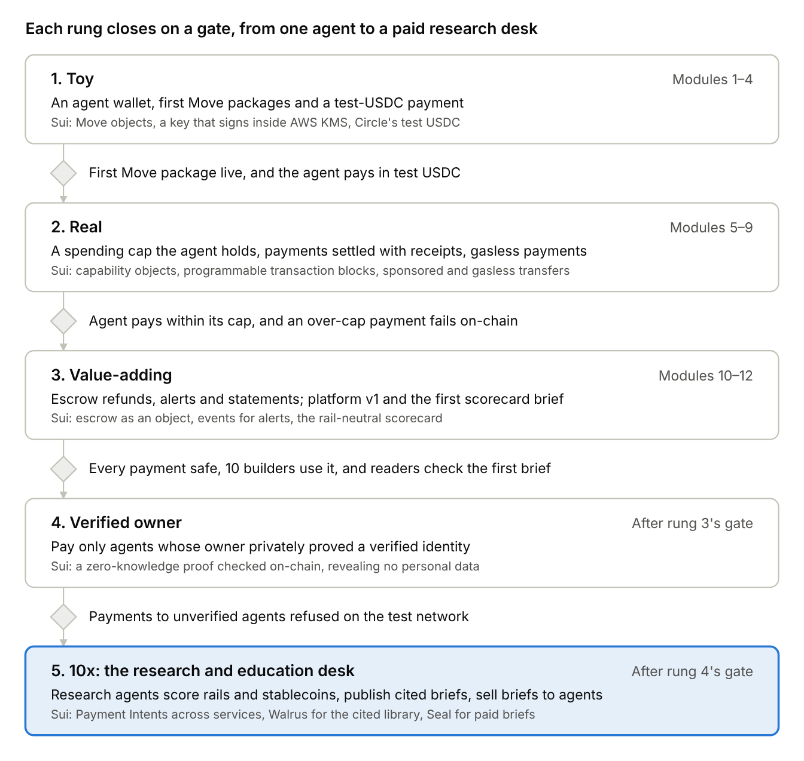
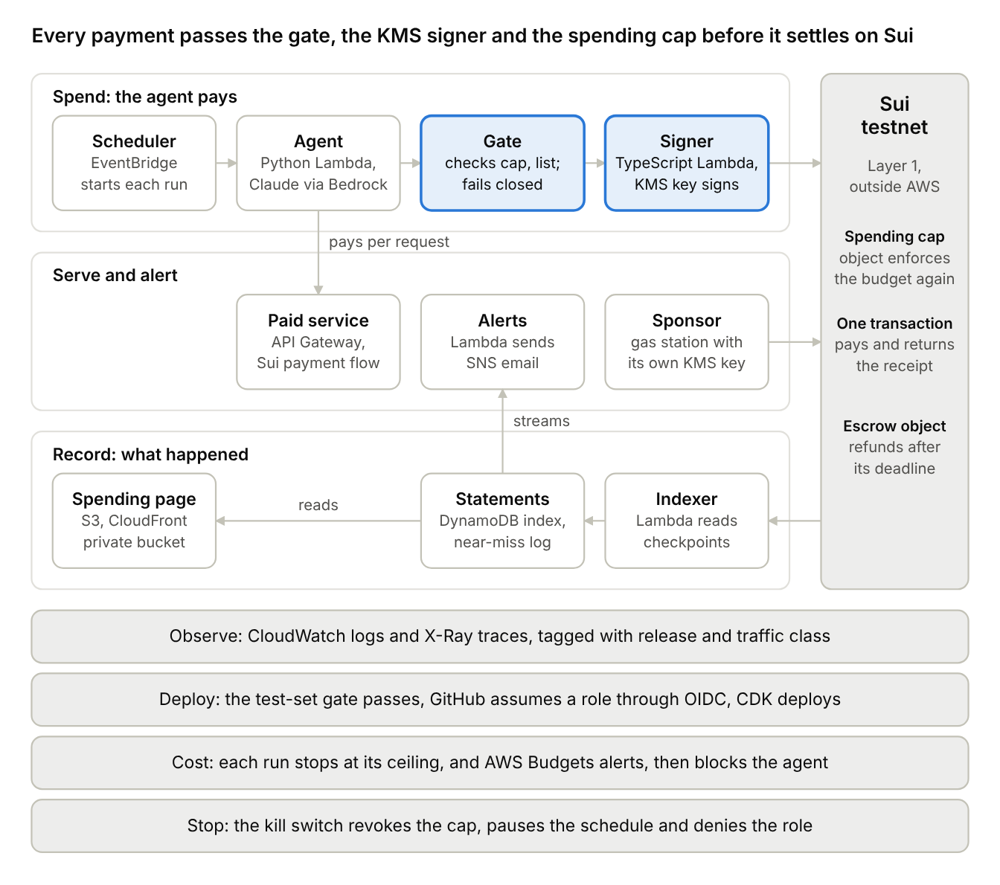

# Ambition Roadmap and Decision Register

Nov 6, 2026 · @dinky

## Summary

**Ambition is an agentic commerce research and education platform on Sui, written in Move from the first module, with stablecoins at its center.** AI agents will pay for things in digital dollars, so Ambition teaches builders how an agent holds and spends stablecoins safely. It also scores every payment rail and stablecoin on one public scorecard, and ships the toolkit that does the spending.

The platform has three parts that feed each other. The toolkit gives an agent a wallet, a spending cap it cannot exceed, payments that settle with their receipts, escrow and alerts. The research desk uses that toolkit to buy data and publish cited briefs on which rails and stablecoins are safe for agents. The education track turns each module into a lesson and a reader challenge that leaves public proof on Sui's test network.

Sui carries the build because its base layer already does what agent payments need. One transaction can settle several steps at once, a spending limit can be an object the agent holds, and beginners can sign in and pay without buying gas. The research stays neutral anyway, because a referee that favors its own rail would lose the trust that makes its briefs worth buying.

**Every decision below was accepted on November 4, 2026, except P-19 to P-22, accepted on November 6, 2026.** This roadmap replaces the earlier Base and Solidity roadmap, which is kept unchanged as a [dated record](archive/agentic-enterprise-roadmap-2026-11-04.md) of its decisions, D-01 to D-26. The plan stays dateless, and dates return when the capstone course begins (P-15).

## Why this platform

**Starting from a blank page, three ambitious DeFi paths on Sui were weighed, and only the platform is both ambitious and reachable for one builder.** The other two need licenses or capital that a student project cannot raise, and Sui's largest players already hold them.

| Path | Verdict | Why |
| --- | --- | --- |
| Issue a stablecoin | No | Under the GENIUS Act, only a regulated "permitted payment stablecoin issuer" may issue one to people in the US, and the law is expected to take effect January 18, 2027. Sui already has dollars from Circle (USDC), Bridge, a Stripe company (USDsui), and Ethena with SUI Group (suiUSDe, plus USDi backed by BlackRock's tokenized money-market fund) |
| Build a trading, lending or derivatives protocol | No | Sui already has DeepBook's shared order book, Suilend, NAVI and Bluefin. The May 2025 Cetus exploit showed that one math bug in an exchange can drain over $220 million, so a new protocol needs deep capital and repeated audits |
| Build an agentic commerce research and education platform | Yes | It sits one layer above the stablecoins, so it needs no license to issue and no pool of other people's money. It uses exactly the Sui features that make agent payments safe, and a neutral scorecard of rails and stablecoins is something no one offers today |

The stablecoin angle survives inside the winning path. Ambition studies, teaches and uses stablecoins rather than issuing one, which keeps the ambition while staying outside the issuer rules. This is a summary of public reporting, not legal advice.

## The case study

**The case study is Ambition itself, growing from one agent with a wallet into a governed desk that other builders' agents pay for research.** It replaces the book's fictional macro-research firm with a real subject, agents paying in stablecoins, so every lesson Ambition teaches is also a part it runs.

| Part | What it does | The Sui features it uses |
| --- | --- | --- |
| Toolkit | Gives an agent a wallet whose key never leaves Cloud KMS, a spending cap it holds as an object, payments that settle together with their receipts, escrow with automatic refunds, alerts and statements | Move objects for the spending cap, programmable transaction blocks (up to 1,024 steps that all succeed or all fail), gasless stablecoin transfers, and Mysten's Google Cloud KMS signer |
| Research desk | Buys public data with the toolkit and publishes cited briefs that score each rail and stablecoin on the same scorecard. It covers risk, safety and how-to, never price calls or personal recommendations | The toolkit's own payments, so every brief is also a live test; Walrus to store the cited library and Seal to control who reads paid briefs, if the desk needs them |
| Education | Turns each module into a plain-language lesson and a reader challenge that leaves public proof on the test network | zkLogin, so a beginner signs in with a familiar login, and sponsored transactions, so a reader's first payment needs no SUI for gas |

The three parts feed each other. A reader learns a module, the toolkit gains a tested part, and the desk spends through that part to produce research. Sui's Payment Intents, which settle one request across several apps at once, join once the desk buys from more than one service in a single step.

## The ladder

**Five rungs take Ambition from one agent with a wallet to a desk that other agents pay for research, and each rung closes on a gate anyone can check.** A missed gate holds the next rung rather than lowering the bar.

Rungs 1 to 3 hold the twelve modules. Rung 5 is the platform's destination rather than one option among several, because the research and education desk is the case study.

## Modules 1 to 12 in Move

**Move starts in module 1, so every module ships a Move package on Sui's test network as well as a lesson.** Each module is done when its check passes, and the order follows The Move Book: objects first, then coins, then the patterns that make agent payments safe. Google Cloud joins in module 1 with a small foundation and adds one service at a time.

| Module | What it builds on Sui | Reader challenge | What runs on Google Cloud |
| --- | --- | --- | --- |
| 1 | An agent wallet whose key is created in Cloud KMS, and a first Move package published to the test network | Get test SUI from the faucet, call the package and reply with the transaction link | Account guardrails and a Cloud Billing budget alert; the agent's key in Cloud KMS; a first Cloud Run service that Terraform deploys from GitHub Actions through Workload Identity Federation, writing the first release manifest |
| 2 | A statement: a script that reads the agent's activity and explains what an object and a checkpoint are | Find your transaction's checkpoint and reply with its number | An indexer Cloud Run service reads the agent's transactions by checkpoint and writes the statement index to Firestore |
| 3 | A shared registry object where agents list a name and a price per request | Add an entry; each one is public proof | No new service, because the registry lives on Sui; the Terraform stack gains its first tests |
| 4 | Test USDC from Circle's faucet and a payment from the agent to another wallet | Send 1 test USDC between two of your own wallets and reply with the link | A TypeScript signer on Cloud Run signs through Mysten's Cloud KMS signer behind a first write-back gate that fails closed, and Cloud Scheduler starts each run through Cloud Workflows |
| 5 | A spending cap the agent holds as an object, with a budget, an expiry and an allowed-recipient list that the owner can suspend or revoke | Grant, then revoke, a cap and reply with the revocation | The gate checks the cap before signing, refused attempts go to the near-miss log, and the kill-switch runbook names its steps |
| 6 | A paid service and a payment that settles with its receipt in one transaction, using Sui's own payment flow | Pay the service once and reply with the receipt object | The service runs on Apigee and Cloud Run; the agent's loop calls Gemini through Vertex AI with a traffic-class tag and a per-run ceiling; the test set starts with 20 cases |
| 7 | Gasless stablecoin payments and sponsored transactions, so the agent and a new reader both pay without holding SUI | Make a first payment with zkLogin and a sponsored transaction | A sponsor Cloud Run service with its own Cloud KMS key runs a gas station that pays readers' gas within a capped budget |
| 8 | Tests, a security checklist and a first kill-switch drill; the module-5 cap is compared with OpenZeppelin's spend vault for Sui | Try to overspend a test cap and reply with the failed transaction | An IAM review, the OWASP agentic-risk mapping, a first Well-Architected review and the first dated drill |
| 9 | Agent version 1: buys data, stays under its cap and logs every payment and refusal | Call the paid service from your own code | Cloud Trace follows every run, and the spending audit comes from Cloud Logging and a BigQuery export |
| 10 | Escrow as an object that holds payment until delivery and refunds after a deadline | Pay into escrow, let the deadline pass and reply with your refund | The deadline lives in the Move object, and a one-time Cloud Scheduler job claims the refund once it passes |
| 11 | Alerts and a public spending page | Trip an alert on your practice wallet and reply with the link | Firestore change events reach an alert Cloud Run service through Eventarc, which emails through a Cloud Monitoring notification channel; Firebase Hosting serves the public page |
| 12 | Ambition version 1, a capstone-style write-up and the first published scorecard brief | Read the brief and score one rail or stablecoin yourself | The architecture diagram, the Google Cloud Architecture Framework review, a cost report from Cloud Billing and the BigQuery billing export, and the rung-3 gate review |

The research desk starts small inside module 12 rather than waiting for a later rung. That way the first scorecard is tested by readers before the desk grows into the multi-agent research operation in rung 5. **Readers never need a Google Cloud account,** because every challenge happens on Sui's test network.

## The rail-neutral scorecard

**Every chain and every stablecoin answers the same eight questions, Sui and its dollars included (P-04).** Sui's own four questions test whether a rail can carry agent payments. The four Ambition adds test whether a builder can trust it, which is the part a vendor's checklist leaves out.

| Question | Asked of | Why it matters to an agent |
| --- | --- | --- |
| Can one workflow settle atomically across several services? | Rails | An agent that pays but never receives what it bought has lost money it cannot reverse |
| Can the protocol enforce a spending limit that travels across apps? | Rails | A limit that each app enforces separately fails the first time an app forgets |
| Do cost and throughput hold when one account drives thousands of payments? | Rails | Agents pay per request, so fees that look small per payment add up |
| Can the agent pay in stablecoins without managing gas? | Rails | An agent that must also hold the chain's own token has two balances to run out of |
| Can anyone, validators or issuers included, freeze or reverse a payment? | Rails and stablecoins | Sui's validators froze about $160 million after the Cetus exploit, and issuers can freeze their own coins, so builders should know who holds that power |
| Can a buyer get a refund when a service fails to deliver? | Rails | Payments are final, so refunds must be built in, usually as escrow |
| Can a reviewer trace why money moved? | Rails | An audit trail is what lets a team lead trust an agent with a budget |
| What backs the dollar, and who can redeem it? | Stablecoins | USDC holds cash and short-term Treasury reserves, USDsui is issued by Bridge to comply with the GENIUS Act, USDi is backed by a tokenized money-market fund, and suiUSDe is a synthetic dollar of digital assets hedged with short futures, so each can fail in a different way |

Each brief scores one rail or stablecoin against these questions, cites a source for every answer, and says "insufficient evidence" where the sources run out.

## Six safety habits

**Six habits from *Building the Agentic Enterprise* carry over unchanged, because none of them depended on the chain (P-10).** Each starts small in an early module, since every one is cheap to begin and expensive to bolt on later.

| Habit | What Ambition does on Sui | Starts in | Book |
| --- | --- | --- | --- |
| Release manifest | Every deploy writes one file naming the model ID, prompt hashes, tool and library versions, Move package IDs and caps, and every statement line names the manifest it ran under | Module 1 | pp. 421–425 |
| Write-back gate that fails closed | Nothing the agent proposes reaches the signer until the gate passes it, and an error, a timeout or a missing record counts as no (P-06) | Module 4, complete in module 5 | pp. 303–304, 692 |
| Kill switch with named steps | The runbook names each step the switch takes: revoke the spending cap, pause the schedule and deny the agent's service account, and the same flag stops the gateway (P-22). A drill at every rung gate from rung 2 on, dated in the log, proves it still stops a test agent within a minute | Module 5, first drill in module 8 | pp. 524, 707 |
| Test-set gate | The test set holds at least 20 cases from module 6. From rung 5 it grows to a 50-query smoke set on every commit and a golden set of 200 or more queries nightly on Google Cloud's Batch tier, against one pass bar of 0.90, and overspending, a wrong recipient or a leaked key must pass 100% | Module 6 | pp. 605, 705 |
| Near-miss log | Every payment the gate refused or sent for approval is logged with its reason, because a near miss is the cheapest warning a system gives | Module 5 | p. 467 |
| Cost tags and a per-run ceiling | Every model call carries a traffic-class tag, such as agent run, test set or reader service. At 90% of a run's ceiling the agent switches to a cheaper model, and at 100% the run stops | Module 6 | pp. 411, 518 |

## The architecture on Google Cloud and Sui

**Every payment passes a gate in code, a signature inside Cloud KMS and the spending cap's own check on Sui before it settles.** Google Cloud runs the agent, its keys and its records, while Sui holds the money and the rules that must never be edited (P-11, P-20).

The agent can propose any payment, but only the gate can pass one to the signer, only the signer holds the key, and the cap object refuses anything over its budget. The agent runs in Python and the signer in TypeScript, because Sui's official SDK and Mysten's KMS signer are TypeScript (P-09).

**The design answers each pillar of Google Cloud's Architecture Framework with a named control, and the rung-3 review checks them again.**

| Pillar | Ambition's answer |
| --- | --- |
| Operational excellence | Only GitHub Actions deploys, through the Terraform stack; every deploy writes a release manifest, every run writes a structured log, and the kill switch is drilled at every rung gate from rung 2 on |
| Security | One least-privilege service account per Cloud Run service, a wallet key that signs only inside Cloud KMS, a spending cap that Sui enforces on its own, Workload Identity Federation instead of stored keys, and a protected root login |
| Reliability | Cloud Run and Firestore run across several zones; reads retry with backoff, payments never retry blindly, the gate fails closed, and the index can be rebuilt from Sui |
| Performance efficiency | Each service gets its own memory and CPU, and Firestore reads by wallet address, its fastest kind of lookup |
| Cost optimization | Cloud Run and Firestore stay within their free quotas, every run stops at its cost ceiling, the gas station's budget is capped, and Cloud Billing budgets alert and then trigger the block through the P-22 function |
| Sustainability | Nothing runs while idle, and Firestore TTL policies clear stale records |

## Books and curriculum

**The books supply disciplines, not the case study.** *Building the Agentic Enterprise* supplies the register, the gates and the six habits, cited by page. *Building AI Agents for Finance* supplies the agent safety rules in the [reading notes](research/building-ai-agents-for-finance-notes.md). The Move Book and Sui's documentation supply Move and Sui.

The MSAIE's Cloud Applications and Architectures specialization supplies the cloud discipline, and the cloud is now Google Cloud, which the book's reference build uses (P-20). Its Blockchain specialization supplies the DeFi risks the scorecard checks. No book or course material goes into Git, because the books' and course's copyright and the Student Code of Conduct bar sharing them, so every fact here cites a public source (P-14).

## Decision Register

**Twenty-two decisions make up the register: eighteen accepted on November 4, 2026, and P-19 to P-22 on November 6.** Their P prefix comes from the proposal they were approved in and keeps them apart from the earlier D-01 to D-26, which live in the dated record. The book's own register holds fifteen rows and warns that more than thirty means decisions are being argued again, so a new decision takes the next ID, P-23, and changes to an old one edit its row.

| ID | Decision | Status | Why | Revisit when |
| --- | --- | --- | --- | --- |
| P-01 | The case study is an agentic commerce research and education platform with three parts, a toolkit, a research desk and an education track, organized around how agents hold and spend stablecoins | Accepted | Each part feeds the others, and no one covers this subject neutrally today | Before module 1 ships |
| P-02 | Build on Sui from module 1, with every on-chain part written in Move | Accepted | Sui's base layer already settles multi-step payments atomically, holds limits as objects and pays gas for beginners | Rung-3 review |
| P-03 | Test money only on Sui's test network: no real-money account, no token and no stablecoin of Ambition's own | Accepted | Payments are final, beginners copy the build, and issuing a dollar requires a license under the GENIUS Act | After an independent audit |
| P-04 | Research is rail-neutral: one scorecard for every chain and stablecoin, Sui included. Briefs cover risk, safety and how-to, cite a source for every answer, may say "insufficient evidence", and never make price calls, trade signals or personal recommendations | Accepted | A referee that favors its own rail loses the trust that makes its briefs worth buying | Before any paid offer to people |
| P-05 | The agent's spending authority is an object it holds, with a budget, an expiry and an allowed-recipient list the owner can suspend or revoke. Ambition builds its own in module 5 and compares it with OpenZeppelin's spend vault in module 8 | Accepted | A limit the chain enforces holds even if every check before it fails | Module 8 |
| P-06 | Control lives outside the model: a write-back gate checks every payment and fails closed, and the agent's key is created in Cloud KMS and never leaves it | Accepted | A fooled model or a crashed check still cannot overspend, and a key that never leaves KMS cannot leak | Only ever tightened |
| P-07 | Every payment settles in the same transaction as its receipt | Accepted | An agent never pays without proof that it received what it bought | Module 6 |
| P-08 | Readers onboard with zkLogin and sponsored transactions, and agents pay with gasless stablecoin transfers where Sui offers them | Accepted | Beginners never buy gas before a first payment, and agents manage one balance instead of two | Module 7 |
| P-09 | Move for on-chain code, TypeScript with Mysten's official SDK for the chain client and KMS signing, and Python for the agent, research and analysis | Accepted | Sui's official tools are TypeScript, and Python support rests on one volunteer maintainer | If an official Python SDK appears |
| P-10 | The six safety habits carry over unchanged: release manifest, fail-closed write-back gate, kill switch with named steps and dated drills, test-set gate, near-miss log and per-run cost ceiling | Accepted | None of them depended on the chain | Each rung gate |
| P-11 | The chain records what must never be edited, such as caps, payments and escrow deadlines, and any off-chain index can be rebuilt from it | Accepted | Anyone can verify the money, and losing the index costs nothing | Module 10 |
| P-12 | Superseded by P-20. The cloud is Google Cloud, not AWS | Superseded | The reference build in the book runs on Google Cloud, and each service the plan needs has a documented counterpart | Rung-3 cost review, on Google Cloud prices |
| P-13 | The research charter excludes measuring fake or wash agent activity | Accepted | That work needs data access and legal review Ambition won't have, and it would turn a teaching desk into a policing one | Before rung 5 |
| P-14 | The Move Book and Sui's documentation join the two current books as reading sources, and no book or course material goes into Git | Accepted | Move replaces Solidity, and the books' and course's copyright and the Student Code of Conduct bar sharing them | Never, for the Git rule |
| P-15 | The plan stays dateless: modules close on checks, rungs close on gates, and dates return when the capstone course begins | Accepted | A gate holds the bar where a date invites lowering it | When the capstone course begins |
| P-16 | Keep the Ambition name and its public repository, with the GitLab mirror and the MIT License unchanged | Accepted | The mission still fits, and keeping the name keeps the repository, its history and readers' links intact | Only if the mission changes |
| P-17 | The paid service uses Sui's own payment flow, not a third-party x402 package | Accepted | x402 has no official Sui implementation, while Sui's own flow settles a payment and its receipt in one transaction with no outside code | If an official x402 implementation for Sui appears |
| P-18 | Apply for a Sui grant or request for proposals, and for the next academic research award Sui announces, whether the 2026 or the 2027 round | Accepted | A grant can fund the build and an independent audit, and the 2025 award program has ended with no next round announced | When Sui announces the next award round |
| P-19 | Superseded by P-21. The first committee had eight units and four specialists | Superseded | P-21 keeps the book's seven units, with the on-chain payments analysis inside the Sector Specialist | Not applicable |
| P-20 | Google Cloud is the platform: Cloud Run, Firestore, Cloud Workflows, Cloud Scheduler and Cloud KMS, with Apigee as the public gateway and a VPC Service Controls perimeter around the research project. Gemini runs the agents on Vertex AI, and Claude on Vertex AI judges their output. This supersedes P-12 | Accepted | The book's reference build proves this design on a real research workload, and a judge from a different vendor than its generators is a stronger check than a different model from the same vendor | If the organization cannot be set up, the perimeter becomes a recorded deviation |
| P-21 | The research committee has seven units, matching Figure 13.1 of the book: the Research Director; the Market Analyst; the Macro Economist (the book's economist, retooled); the Sector Specialist, which includes the on-chain payments analysis for Sui; the Findings Generator (the book's Thesis Generator); the Compliance Agent as a gate; and the Report Writer. This replaces P-19 | Accepted | Each data domain keeps one owner, and the committee keeps the book's shape: three specialists under the Director | When the agent specifications set each unit's module and cost |
| P-22 | Tests and the kill switch follow the book. Every commit runs a 50-query smoke set; a golden set of 200 or more queries runs nightly on Google Cloud's Batch tier; the gate is 0.90 on the golden set and 4.5 on the five-point judge scale; a canary takes 5% of traffic after 24 hours of shadow running. The kill switch runs through a Cloud Monitoring alert, Pub/Sub, a Cloud Function and a Firestore flag that the gateway and every service check. This amends P-10 | Accepted | The book's nightly run is affordable on Batch, and the kill switch must stop the gateway as well as the agents | If Batch is unavailable for the Claude judge, the nightly judge runs on replayed outputs and the change is recorded |

## Plain-language terms

| Term | Plain meaning |
| --- | --- |
| Agentic commerce | AI agents buying and selling on their own, paying per request in digital dollars |
| Apigee | Google Cloud's API gateway, which checks who may call an API, sets rate limits and tiers clients |
| Atomic transaction | A set of steps that all succeed or all fail together, so nothing is left half done |
| Batch tier | Google Cloud's lowest-cost model tier, with up to a 24-hour turnaround, used here for the nightly golden set |
| BigQuery | Google Cloud's analytics warehouse, here the audit and billing record |
| Capability | An object that grants a power, such as spending up to a budget; whoever holds it has that power |
| Checkpoint | A numbered batch of Sui transactions that the network has finalized, like a page in its record book |
| Cloud Billing budgets | Google Cloud's spending alerts, which can also trigger a function that blocks chosen services once spend passes a set amount |
| Cloud KMS | Google Cloud Key Management Service, which keeps keys inside secure hardware and signs with them there |
| Cloud Logging | Google Cloud's log service, where every Cloud Run service writes what it did |
| Cloud Run | Google Cloud's way to run a container without managing a server; it scales to zero and bills per request |
| Cloud Scheduler | A Google Cloud service that starts a job at a set time or on a repeating schedule |
| Cloud Trace | Google Cloud's tracing service, which follows one request through every service it touches |
| Cloud Workflows | Google Cloud's service for running a multi-step process in order, with retries and checkpoints |
| Cost ceiling | The most one agent run may spend on models and services; near it the agent switches to a cheaper model, and at it the run stops |
| DeepBook | Sui's shared order book, where many apps draw on the same pool of buy and sell orders |
| Done-When | A check anyone can run that says a piece of work is finished, written before the work starts |
| Escrow | Holding a payment until the service delivers, then refunding it if a deadline passes |
| Eventarc | Routes events, such as a database change, to a Google Cloud service |
| Fail closed | When a check breaks, times out or lacks the data it needs, its answer is no |
| Firestore | Google Cloud's database that stores records by a key and needs no server to manage |
| Gas station | A service that pays other people's network fees, here within a capped budget |
| Gasless transfer | Sending a stablecoin without paying the network fee in the chain's own token |
| Gemini | Google's family of AI models; Pro handles the hardest reasoning and Flash the fast, routine work |
| GENIUS Act | The 2025 US law that sets who may issue a payment stablecoin and how it must be backed |
| Google Cloud Architecture Framework | Google Cloud's checklist of design principles for judging a cloud design |
| Kill switch | A fast way to stop an agent: here, revoking its spending cap, pausing its schedule and denying its service account |
| Layer 1 | A blockchain that settles its own transactions with its own validators, such as Sui |
| Move | The programming language for Sui code, built so a digital asset cannot be copied or lost by mistake |
| Near-miss log | A record of every payment the gate refused or sent for approval, with its reason, read for warnings before a real loss |
| Object | Sui's basic unit of data: every coin, cap and receipt is an object with an owner |
| Payment Intents | A Sui feature that settles one request across several apps in a single transaction |
| Programmable transaction block | One Sui transaction that chains up to 1,024 steps, all of which succeed or fail together |
| Pub/Sub | Google Cloud's message service, which passes events between services without them calling each other directly |
| Rail | The network and rules a payment travels on, such as a blockchain or a card network |
| Release manifest | One file per deploy listing exactly which model, prompts, tools, Move packages and caps are running |
| Seal | Sui's encryption with access control, which decides who can read stored data |
| Service account | An identity that code takes on, with permissions set in Google Cloud IAM, instead of holding a password or key |
| Sponsored transaction | A transaction whose network fee someone else pays, so a new user needs no SUI |
| Stablecoin | A token designed to hold a steady value, such as one US dollar |
| Synthetic dollar | A token that tracks a dollar through offsetting trades rather than cash reserves |
| Terraform | A tool that describes cloud resources in code, so the whole setup can be reviewed, tested and rebuilt |
| Test network | A practice blockchain where all money is free and worthless |
| Test set | A fixed list of tasks with known right answers that every change must pass |
| Tokenized money-market fund | Shares in a fund of short-term government debt, recorded as tokens on a blockchain |
| Traffic class | A tag on every model call saying what it was for, such as an agent run, a test or a reader request, so costs can be split by purpose |
| Validator | A computer that checks and records a blockchain's transactions |
| Vertex AI | Google Cloud's platform for calling AI models such as Gemini and Claude, authorized by Google Cloud identity instead of a separate API key |
| VPC Service Controls | A Google Cloud perimeter that stops data from leaving a set of projects except through rules the owner writes |
| Walrus | Sui's storage network for large files, such as a library of cited sources |
| Workload Identity Federation | A Google Cloud feature that lets GitHub prove who it is and receive short-lived credentials, so no Google Cloud key is stored |
| Write-back gate | The checkpoint between what an agent proposes and anything that changes the world, such as a payment |
| zkLogin | A Sui sign-in that creates a wallet from a familiar login without revealing that login on the chain |

## Sources

- Sui, [DeFi on Sui](https://www.sui.io/defi), on DeepBook, programmable transaction blocks, zkLogin, sponsored transactions, Walrus, Seal and Nautilus
- Sui Foundation, [Blockchain for AI agents and agentic commerce](https://sui.io/blog/blockchain-for-ai-agents-agentic-commerce-sui) (September 2, 2026), the four questions, Payment Intents and gasless stablecoin transfers
- Sui, [USDsui, a native stablecoin issued by Bridge, a Stripe company](https://www.sui.io/blog/sui-unveils-usdsui-native-stablecoin) (November 12, 2025)
- Sui, [Sui, SUIG and Ethena to launch native suiUSDe](https://www.sui.io/blog/suig-ethena-suiusde-stablecoin) (October 1, 2025), on suiUSDe and USDi
- Sui Documentation, [zkLogin](https://docs.sui.io/concepts/cryptography/zklogin), [Sponsored transactions](https://docs.sui.io/concepts/transactions/sponsored-transactions) and [Get coins](https://docs.sui.io/guides/developer/getting-started/get-coins)
- Jones Day, [US Treasury proposes GENIUS Act rules for stablecoin issuance, offer and sale](https://www.jonesday.com/en/insights/2026/08/us-treasury-proposes-genius-act-rules-for-stablecoin-issuance-offer-and-sale) (August 2026)
- Blockworks, [$160M in stolen funds puts Sui's decentralization to the test](https://blockworks.co/news/suis-decentralization-dex-put-to-the-test), on the Cetus exploit and the validator freeze
- OpenZeppelin, [Contracts for Sui: delegated spending](https://docs.openzeppelin.com/contracts-sui/1.x/guides/delegated-spending), on the spend vault
- Mysten Labs, [Google Cloud KMS signer](https://sdk.mystenlabs.com/sui/cryptography/signers/gcp-kms), on signing Sui transactions with a key that never leaves Cloud KMS
- PyPI, [pysui](https://pypi.org/project/pysui/1.3.0/), the community Python SDK for Sui
- pkgstats, [@tentaclepay/sui-x402](https://www.pkgstats.com/pkg:@tentaclepay/sui-x402), a third-party x402 package for Sui
- Circle, [Testnet faucet](https://faucet.circle.com), which lists Sui's test network for test USDC
- Damir Shamanaev and contributors, [The Move Book](https://move-book.com), the guide to Move on Sui
- Sui Forums, [Apply for an academic research award](https://forums.sui.io/t/apply-for-an-academic-research-award/49276), on the ended 2025 program
- OWASP GenAI Security Project, [OWASP Top 10 for Agentic Applications for 2026](https://genai.owasp.org/resource/owasp-top-10-for-agentic-applications/) (December 9, 2025)
- Google Cloud, [Architecture Framework](https://cloud.google.com/architecture/framework), the design principles used for the module 12 review
- Google Cloud, [Set budgets and budget alerts](https://cloud.google.com/billing/docs/how-to/budgets), on alerts that can publish to Pub/Sub when spend passes a threshold
- Google Cloud, [Workload Identity Federation](https://cloud.google.com/iam/docs/workload-identity-federation), on deploying from GitHub without long-lived Google Cloud keys
- Google Cloud, [Batch predictions with Anthropic Claude models](https://docs.cloud.google.com/vertex-ai/generative-ai/docs/partner-models/claude/batch), on the batch tier for Claude on Vertex AI
- Anthropic, [Claude on Vertex AI](https://platform.claude.com/docs/en/api/claude-on-vertex-ai), on the judge's model access
- Jaroslav Pantsjoha, [*Building the Agentic Enterprise*](https://www.oreilly.com/library/view/building-the-agentic/9781807604455/) (Packt, September 2026), for the register, gates and six habits, cited by page
- Hanane Dupouy and Fayssal El Mofatiche, [*Building AI Agents for Finance*](https://reference-global.com/book/9781837022281) (Packt, 2026), with Ambition's adopted rules in the [reading notes](research/building-ai-agents-for-finance-notes.md)
- Ambition, [Build in Public: Mission and Ladder](build-in-public-plan.md), the modules, ladder and gates in plan form
